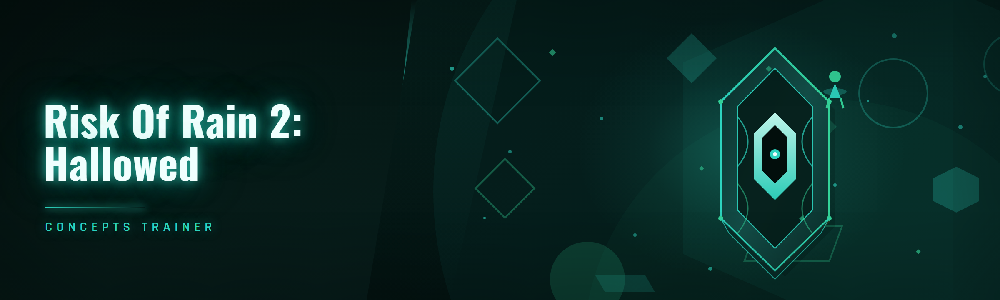

  
  
  

  

  
  
  

---

## 🎮 Overview

**Risk of Rain 2: Hallowed Concepts Trainer** is a 2026 rebuild of my original 2024 sandbox tool. I made it because the 2024 fork had become a dependency soup — three separate runtimes, a fragile memory scanner that broke every patch, and a config loader that choked on modded runs. The 2026 release is a single static `.exe`, 41 modules, and it stays out of your way unless you actually want it in your save file.

The trainer hooks into the HCM (Hallowed Concepts Mod) runtime layer that the community uses to extend Risk of Rain 2's survivor roster and stage logic. If you've ever tried to test a custom survivor at stage 40 without sitting through a 90-minute run, this is for you.

| Category | Details |
|---|---|
| Target | Risk of Rain 2 (Steam, PC) |
| Runtime | .NET 8 self-contained, single `.exe` |
| Hook layer | HCM runtime bridge (external, no DLL injection into base game) |
| Module count | 41 across 6 subsystems |
| Config format | TOML, hot-reloadable |
| Signature updates | Manual refresh via in-app updater |

  

---

## 🩸 The Problem

If you've spent any real time in the Hallowed Concepts modding scene, these will sound familiar:

- **Stage 40 testing is a slog.** You want to check whether your custom survivor's proc coefficient holds up against Mithrix — but reaching that point legitimately eats 60+ minutes.
- **The 2024 fork's memory scanner breaks on every RoR2 patch.** A single assembly offset shift and the whole thing falls over with a null reference.
- **Modded runs trip the trainer's item validation.** The Hallowed Concepts mod adds item IDs that aren't in the vanilla registry, so vanilla item-granting tools just refuse to spawn them.
- **Config profiles don't survive between survivor loadouts.** You rebuild your loadout config from scratch every time you switch from Commando to your custom survivor.
- **Every "all-in-one" trainer ships a bloated Electron UI.** 400MB install, 12 background processes, one of them a telemetry daemon you never agreed to.
- **Time-scale changes desync multiplayer.** The trainer's timescale slider doesn't respect RoR2's network tick, so co-op runs desync within seconds.
- **No way to dump the current run state to a file.** Debugging a broken proc chain means staring at the log and guessing.

---

## 🔧 The Solution

| Problem | Solution |
|---|---|
| Stage 40 testing is slow | Stage jump module with curated checkpoints + director state preservation |
| Scanner breaks on patch | Signature-resilient pattern scanner with a fallback AOB list the community can update |
| Custom items rejected | HCM item registry bridge — reads the mod's runtime inventory directly |
| Config profiles lost | Named loadout profiles stored as TOML, auto-swapped on survivor detection |
| Bloated UI | Single 4MB `.exe`, no installer, no background service |
| Co-op desync | Timescale module respects the network tick and clamps to safe values in multiplayer |
| No run dump | Run state serialization module — writes a JSON snapshot to disk on hotkey |

---

## 🧩 Key Features

| Feature | Description | Benefit |
|---|---|---|
| HCM Registry Bridge | Reads Hallowed Concepts mod's runtime item and survivor registries | Grant modded items without manual ID lookup |
| Signature-Resilient Scanner | Pattern-scan with AOB fallback list | Survives most RoR2 patches without a rebuild |
| Loadout Profiles | Named TOML profiles, auto-swap on survivor change | Stop rebuilding configs every run |
| Run State Dump | Serialize current run to JSON | Debug proc chains and item stacks offline |
| Network-Safe Timescale | Clamps timescale in multiplayer | No more co-op desync |
| Director Inspector | View and modify director spawn weights live | Test balance changes in-session |
| Hot-Reload Config | Edit TOML while running, changes apply instantly | No restart needed |
| Checkpoint Save | Snapshot a run at any stage and reload it | Skip the 60-minute walk to Mithrix |
| Mod-Aware Item Spawn | Spawns items by mod namespace + ID | Works with any HCM-compatible item mod |
| Log Mirror | Mirrors the game's log to a side file with trainer events interleaved | Trace what the trainer touched and when |

---

## 🚀 Quick Start

1. 🎯 Head to the project landing page and grab the current `.exe` — it's a single file, no installer.
2. 📦 Extract to a folder you control (not `Program Files` — you'll want write access for configs and run dumps).
3. ▶️ Launch Risk of Rain 2 first, get to the main menu, then run the `.exe`.
4. 🧠 Let the scanner attach (status line goes green), then open the module panel and enable what you need.
5. 💾 Save a loadout profile before you start tweaking — it's the undo button you'll forget you need.

---

## 📥 Installation

**Step 1 — Download and extract.**
Grab the `.exe` from the landing page. Extract it anywhere you have write permissions. The trainer writes `config.toml`, `profiles/`, and `dumps/` next to itself — keep that folder out of any synced cloud directory unless you like merge conflicts.

**Step 2 — First launch and attach.**
Run the `.exe`. It'll sit idle until it finds a Risk of Rain 2 process. Start the game, and the trainer's attach indicator will flip from red to green within a couple seconds. If it stays red, check the Known Issues table below — the most common cause is an anti-cheat-adjacent overlay (RTSS, Discord overlay) grabbing the process handle first.

**Step 3 — Configure profiles and module toggles.**
Open the module panel, enable what you want, and save the current state as a named profile. The trainer detects your active survivor via the HCM registry bridge and can auto-swap profiles so your Commando setup doesn't follow you into a custom survivor run.

---

## 💡 Tips for Best Results

- **Run the trainer after the game reaches the main menu**, not before launch — the scanner needs the game's module set fully loaded.
- **Use the checkpoint save before enabling director manipulation** — director changes are irreversible mid-run without a reload.
- **Keep the AOB fallback list updated** — the community pushes updated signature lists to the repo's `signatures/` directory after major patches.
- **Disable the timescale module in multiplayer** unless you're the host and everyone's agreed to it — the clamp is safe but players will notice.
- **Dump run state before you report a bug** — the JSON snapshot makes triage about 10x faster.
- **Don't run the trainer on a save you care about** without a backup — the item registry bridge writes to the save on some code paths.

---

## 🧠 Feature Modules

### 🌿 Survivor & Loadout (7 modules)

1. **Survivor Switcher** — Swap your active survivor mid-run without restarting. Respects HCM-registered custom survivors.
2. **Loadout Profile Auto-Swap** — Saves and restores per-survivor loadouts as named TOML profiles.
3. **Skill Cooldown Override** — Per-skill cooldown multiplier, clamped to a safe minimum to avoid animation desync.
4. **Primary Fire Rate Tuning** — Adjusts the primary attack's fire rate within animation-safe bounds.
5. **Survivor Stat Snapshot** — Dump current base stats, item mods, and proc coefficients to a readable table.
6. **Custom Survivor Registry Viewer** — Lists every HCM-registered survivor with its internal ID and hook points.
7. **Loadout Import/Export** — Move profiles between machines as single TOML files.

### 🎒 Item & Inventory (8 modules)

1. **HCM Item Spawner** — Spawn any item by mod namespace + ID. Reads the live registry, no hardcoded lists.
2. **Inventory Editor** — Add, remove, and stack-adjust inventory entries live.
3. **Item Stack Dump** — Serialize the full inventory to JSON with per-item source tracking.
4. **Equipment Swapper** — Force-equip any equipment, including modded equipment.
5. **Proc Coefficient Inspector** — Live readout of effective proc coefficients per item and skill.
6. **Item Drop Table Viewer** — Show the current run's resolved drop table.
7. **Lunar Item Toggle** — Force-include or exclude lunar items from the current drop pool.
8. **Inventory Snapshot/Restore** — Save inventory state to disk, reload into a fresh run.

### 🌍 Stage & Director (7 modules)

1. **Stage Jump** — Jump to any stage index, preserving director state where possible.
2. **Checkpoint Save** — Snapshot the full run state at the current stage.
3. **Checkpoint Load** — Restore a checkpoint into a new run slot.
4. **Director Spawn Weight Editor** — Modify spawn weights live, per-monster.
5. **Teleporter Charge Override** — Set teleporter charge percentage directly.
6. **Stage Time Freeze** — Pause the difficulty timer without pausing the game.
7. **Monster Director Inspector** — View active director credits and pending spawn queue.

### ⏱️ Time & Difficulty (6 modules)

1. **Network-Safe Timescale** — Clamp-aware timescale multiplier; safe in co-op.
2. **Difficulty Scaling Override** — Override the difficulty coefficient curve.
3. **Time Freeze** — Freeze the run timer (separate from stage time freeze).
4. **Difficulty Preset Swap** — Change difficulty mid-run with a warning prompt.
5. **Run Timer Readout** — Live timer with per-stage breakdown.
6. **Elite Spawn Rate Modifier** — Adjust elite spawn probability.

### 🛠️ Debug & Diagnostics (7 modules)

1. **Run State Dump** — Write a full JSON snapshot to `dumps/` on hotkey.
2. **Log Mirror** — Mirror the game log with trainer events interleaved.
3. **Pattern Scanner Status** — Live scanner state, current signature version, fallback list status.
4. **Hook Trace** — Log every trainer hook invocation with timestamps.
5. **Crash Snapshot** — On trainer crash, write a pre-crash state file for triage.
6. **Memory Region Inspector** — Read-only view of the game's loaded modules.
7. **Config Validator** — Validate `config.toml` against the current schema and report drift.

### 🖥️ Interface & Config (6 modules)

1. **TOML Hot-Reload** — Edits to `config.toml` apply without restart.
2. **Profile Manager** — Named loadout profiles with auto-swap rules.
3. **Hotkey Rebinder** — Rebind every hotkey; conflicts are detected on save.
4. **Overlay Toggle** — Minimal in-game overlay for status and hotkey hints.
5. **Theme Switch** — Dark/light UI themes.
6. **CLI Mode** — Headless mode for scripted run-state dumps.

---

## ⌨️ Default Hotkeys

| Action | Default |
|---|---|
| Toggle overlay | `F8` |
| Dump run state | `F9` |
| Toggle timescale module | `F10` |
| Open module panel | `Insert` |
| Save current profile | `Ctrl+Shift+S` |
| Emergency disable all modules | `Ctrl+Shift+Backspace` |

---

## 🖥️ System Requirements

| Component | Minimum | Recommended |
|---|---|---|
| OS | Windows 10 21H2 | Windows 11 23H2 |
| Runtime | .NET 8 Desktop Runtime | .NET 8 Desktop Runtime |
| RAM | 4 GB free | 8 GB free |
| Disk | 50 MB | 500 MB (for dumps and checkpoints) |
| Game | Risk of Rain 2 (Steam, current patch) | Same, plus HCM mod installed |
| Permissions | Standard user | Admin (needed for some hook paths) |

---

## 🩺 Known Issues

| Issue | Fix |
|---|---|
| Attach indicator stays red | Close RTSS / Discord overlay / MSI Afterburner; restart trainer |
| Timescale desyncs in co-op | Ensure network-safe mode is enabled (default); reduce multiplier to 2x max |
| Custom survivor not listed | Verify HCM mod version matches trainer's registry bridge version |
| Config validation warning on launch | Run the Config Validator module; regenerate with `--reset-config` flag |
| Checkpoint load crashes game | Delete corrupt checkpoint from `dumps/`; re-save from a stable stage |
| Hotkeys not firing | Check for conflicts in Hotkey Rebinder; some laptops reserve `F8`–`F10` |

---

## 🗺️ Roadmap / Planned Features

| Feature | Status | ETA |
|---|---|---|
| Custom survivor stat editor GUI | 🚧 In progress | Q2 2026 |
| AOB signature auto-update via GitHub | 🚧 In progress | Q2 2026 |
| Multiplayer-safe director tools | 📋 Planned | Q3 2026 |
| Linux via Proton (experimental) | 📋 Planned | Q4 2026 |
| Scripted run automation API | 📋 Planned | TBD |
| Item mod authoring toolkit | 💭 Exploring | TBD |

---

## ❓ FAQ

1. **Is this a cheat for Risk of Rain 2?**
   It's a single-player sandbox trainer for the Hallowed Concepts modding community. It hooks into the HCM runtime layer so modders can test custom survivors and items without grinding to stage 40 every time. Use it in single-player or with friends who've agreed to it — it's not built for competitive or public-lobby use.

2. **Do I need the Hallowed Concepts Mod installed?**
   Not strictly — most vanilla modules work without it. But the HCM Registry Bridge, custom survivor switcher, and modded item spawner require HCM. Without it, those modules gracefully disable themselves.

3. **Does it work with the current RoR2 patch?**
   Yes, assuming you're on the current Steam patch. The signature-resilient scanner handles most patches, but major assembly changes still need an updated AOB list. Check the `signatures/` directory in the repo after a patch drops.

4. **Why does my antivirus flag the `.exe`?**
   Because it hooks into another process's memory — that's what any trainer does. The binary is unsigned (I'm one person, not a company). If that's a dealbreaker, don't run it. If you're curious, the source for the scanner and hook layer is in the repo.

5. **Where does it save configs and dumps?**
   Next to the `.exe`: `config.toml`, `profiles/`, `dumps/`. No registry writes, no `AppData` sprawl, no background service.

6. **Can I use it in co-op?**
   Yes, but carefully. The timescale module has a network-safe clamp specifically to prevent desync. Director and checkpoint modules should only be used when you're host and everyone's aware.

7. **What's different from the 2024 fork?**
   Three runtime dependencies collapsed into one self-contained `.exe`. The memory scanner got a fallback AOB list that survives patches. Config format moved from JSON to TOML with hot-reload. And the item spawner now reads the HCM registry directly instead of hardcoding vanilla IDs.

8. **Does it touch my save file?**
   Only the item registry bridge and inventory editor write to the save on some code paths. Back up your save before using those modules. Everything else is in-memory.

9. **How do I update it?**
   Download the new `.exe` from the landing page, replace the old one, keep your `config.toml` and `profiles/` folder. Config schema changes are handled by the Config Validator on launch.

10. **Why a `.exe` and not source?**
    The landing page distributes a prebuilt `.exe` for end users who just want to run the thing. Source lives in the repo for anyone who wants to build it themselves — but the download path is download → extract → run.

11. **What's the emergency disable hotkey?**
    `Ctrl+Shift+Backspace`. It disables every active module and detaches the hooks. Use it if something goes sideways mid-run.

12. **Will this get me banned?**
    Risk of Rain 2 doesn't have a competitive anti-cheat. The risk is between you and whoever you play with. I won't claim it's undetectable — I'll just say it's a single-player modding tool, and you should treat it like one.

---

## 📜 Changelog / Release History

| Version | Date | Changes |
|---|---|---|
| 2026.1.0 | 2026-01-14 | Initial 2026 release. 41 modules. HCM registry bridge, TOML hot-reload, checkpoint save/load, network-safe timescale. |
| 2026.0.9 | 2025-12-02 | Beta: signature-resilient scanner with AOB fallback, log mirror, crash snapshot. |
| 2026.0.5 | 2025-10-21 | Beta: survivor switcher, loadout profile auto-swap, hotkey rebinder. |
| 2026.0.1 | 2025-09-08 | Alpha: HCM registry bridge prototype, basic item spawner. |
| 2024.12 | 2024-12-01 | Last 2024 fork release. Three-runtime dependency chain, JSON config, no fallback scanner. |

---

## 🧭 Get Started

1. 🎮 Launch Risk of Rain 2 to the main menu.
2. 📂 Extract the `.exe` to a writable folder.
3. ▶️ Run the `.exe` and wait for the attach indicator.
4. 🧱 Open the module panel, enable what you need, save a profile.
5. 💾 Back up your save before touching the item registry bridge.

  

---

Built this for my own stage-40 testing grind and open-sourced it because the 2024 fork was getting in my way. If you're modding Hallowed Concepts survivors, the checkpoint system alone will save you hours. Bug reports with a run-state dump attached get triaged first — everything else goes in the pile. Fork it, patch the AOB list, send PRs.
